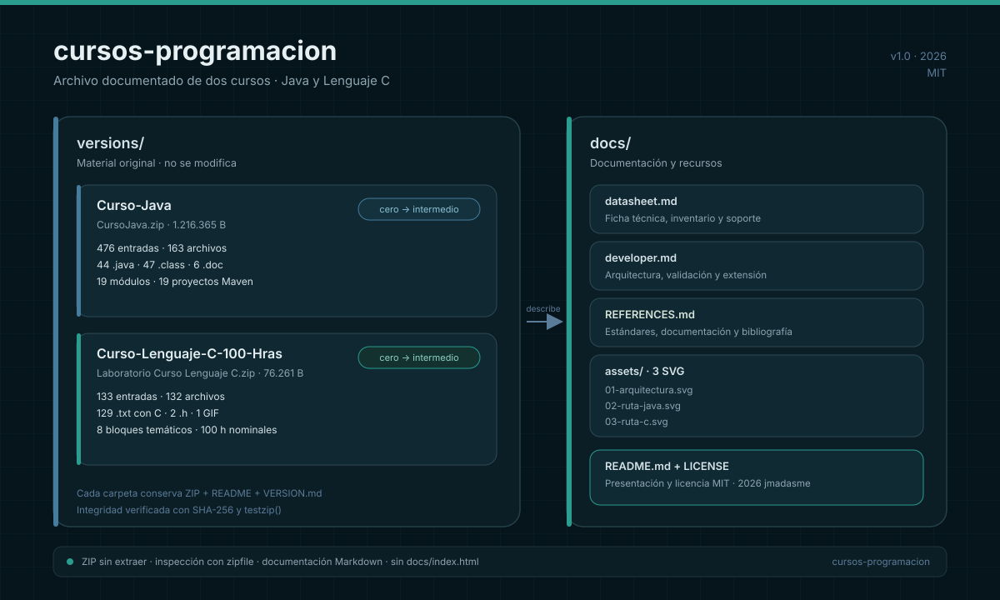
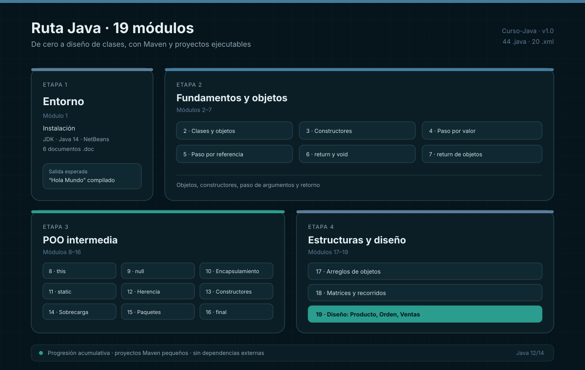
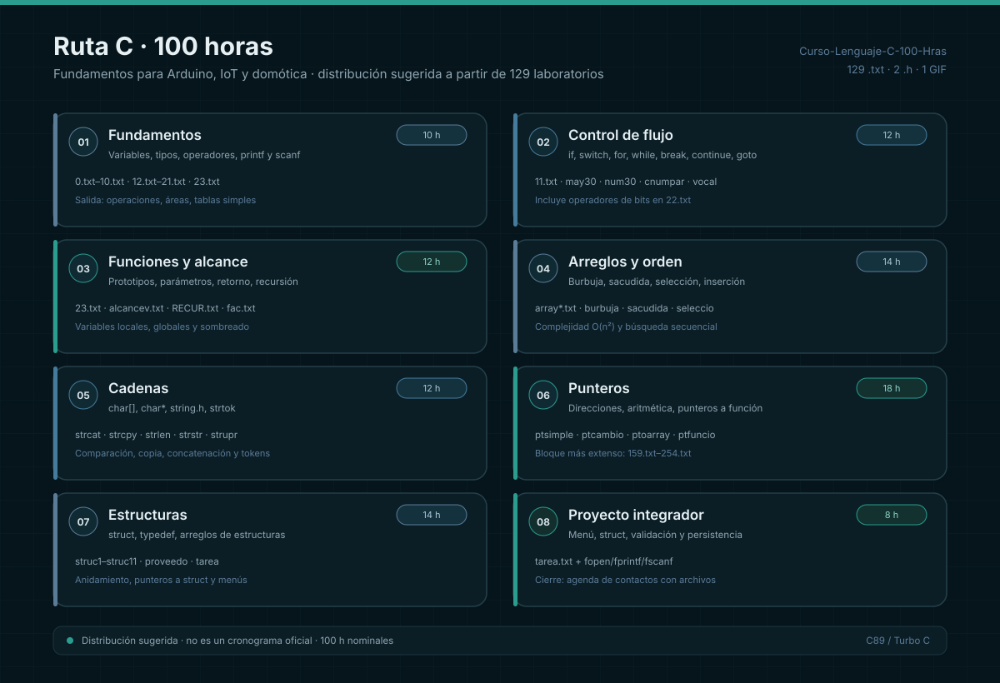

# Cursos de Programación · Java y Lenguaje C

<p align="center">
  
</p>

<p align="center">
  <em>Dos cursos de introducción a la programación, preservados como material didáctico y acompañados de documentación técnica.</em>
</p>

---

## Contenido

1. [Propósito](#1-propósito)
2. [Qué contiene el repositorio](#2-qué-contiene-el-repositorio)
3. [Aviso honesto](#3-aviso-honesto)
4. [A quién está dirigido](#4-a-quién-está-dirigido)
5. [Requisitos](#5-requisitos)
6. [Cómo descomprimir](#6-cómo-descomprimir)
7. [Curso de Java](#7-curso-de-java)
8. [Curso de Lenguaje C · 100 horas](#8-curso-de-lenguaje-c--100-horas)
9. [Plan de estudio sugerido](#9-plan-de-estudio-sugerido)
10. [Diagramas](#10-diagramas)
11. [Verificación técnica](#11-verificación-técnica)
12. [Solución de problemas](#12-solución-de-problemas)
13. [Advertencias](#13-advertencias)
14. [Documentación y licencia](#14-documentación-y-licencia)

---

## Modelo de acceso

La **primera versión** (`Curso-Java`) es pública y gratuita: es el punto de partida para entender el proyecto, probarlo y construir sobre él. La **versión restante** son privadas y se comparten solo mediante solicitud.
> **Alcance del repositorio público:** solo está incluida `versions/Curso-Java`. Las rutas a otras versiones se mencionan como referencia histórica y no forman parte de este repositorio; se comparten por solicitud.


> **Última versión: privada.** Las mejoras, optimizaciones, depuraciones y variantes de hardware no se entregan de forma anónima: se solicitan y se acuerdan con un alcance claro.

**[Solicitar acceso / licencia](https://github.com/jmadasme/cursos-programacion/issues/new?template=solicitud-acceso.yml&title=Solicitud%20de%20acceso%20a%20versiones%20privadas)**

| Versión | Acceso | Enlace |
|---|---|---|
| `Curso-Java` | Pública | [Ver carpeta](versions/Curso-Java/) |
| `Curso-Lenguaje-C-100-Hras` | Privada | [Solicitar acceso](https://github.com/jmadasme/cursos-programacion/issues/new?template=solicitud-acceso.yml&title=Solicitud%20de%20acceso%20a%20versiones%20privadas) |

La licencia MIT de este repositorio se aplica únicamente a la primera versión pública. Las versiones privadas se rigen por el acuerdo de acceso correspondiente.

## 1. Propósito

Este repositorio reúne **dos cursos completos de programación** dictados por jmadasme y conservados en su formato original: dos archivos ZIP, cada uno con su README y su ficha de versión. El objetivo es preservarlos, describirlos con precisión y permitir que otra persona los estudie o adapte sin abrir primero los comprimidos a ciegas.

Los cursos son complementarios:

- **Curso de Java**: parte desde cero y llega hasta el diseño de clases, la herencia, el encapsulamiento, los arreglos, las matrices y la organización en paquetes. Es la entrada a la **programación orientada a objetos** y a Maven.
- **Curso de Lenguaje C · 100 horas**: trabaja la base imperativa y de memoria —variables, control de flujo, funciones, arreglos, cadenas, punteros y estructuras— con enfoque de laboratorio. El autor lo presenta como base para **Arduino, IoT y domótica**.

La convivencia tiene sentido pedagógico: C muestra cómo funcionan la memoria y el control; Java muestra cómo modelar un problema con objetos y organizar un programa grande. Muchos ejemplos de C (punteros, estructuras, arreglos de caracteres) reaparecen en Java de forma más segura y abstracta.

> **Es un archivo documentado, no una plataforma de e-learning.** No hay videos, diapositivas, inscripción, evaluaciones automáticas ni servidor. Hay material empaquetado y la documentación necesaria para usarlo.

### 1.1. Qué resuelve

Un ZIP olvidado es difícil de evaluar: no se sabe qué contiene, en qué estado está, qué versión de Java o C espera, ni si sus ejemplos compilan. Este repositorio aporta un **inventario verificable** (476 registros en Java, 133 en C), **contexto de uso** (requisitos, descompresión, compilación y ejecución), **límites explícitos** (archivos incompletos, dependencias históricas y erratas) y **trazabilidad** (hash SHA-256, ficha de versión y origen declarado).

### 1.2. Qué no es

No es una versión modernizada —los ZIP no se modifican—, ni un curso nuevo, ni un paquete instalable, ni una biblioteca de código, ni un repositorio con historial Git propio en el momento de la importación. La autoría del material original es de jmadasme.

---

## 2. Qué contiene el repositorio

### 2.1. Vista rápida

| Dimensión | Curso de Java | Curso de Lenguaje C |
|---|---|---|
| Carpeta | `versions/Curso-Java/` | `versions/Curso-Lenguaje-C-100-Hras/` |
| ZIP | `CursoJava.zip` | `Laboratorio Curso Lenguaje C.zip` |
| Tamaño del ZIP | 1.216.365 bytes (≈1,16 MiB) | 76.261 bytes (≈74,5 KiB) |
| Descomprimido | 1.317.620 bytes (≈1,26 MiB) | 85.322 bytes (≈83,3 KiB) |
| Entradas | 476 (313 directorios + 163 archivos) | 133 (1 directorio + 132 archivos) |
| Código | 44 `.java`, 47 `.class` | 129 `.txt` con C, 2 `.h` |
| Documentos | 6 `.doc` de instalación | — |
| Auxiliares | 20 `.xml` (poms), 40 `.lst` | 1 GIF (tabla ASCII) |
| Organización | 19 módulos numerados | 129 laboratorios + 2 cabeceras |
| Nivel | Cero a intermedio/avanzado | Cero a intermedio |
| Herramientas | JDK 12/14, Maven, IDE | Compilador C89, editor |
| Estado | Material de curso, sin tests | Material de curso, sin tests |

### 2.2. Mapa

```text
cursos-programacion/
├── README.md
├── LICENSE                         # MIT, Copyright (c) 2026 jmadasme
├── docs/
│   ├── datasheet.md                # ficha de usuario e inventario
│   ├── developer.md                # arquitectura y mantenimiento
│   ├── REFERENCES.md               # estándares y bibliografía
│   └── assets/
│       ├── 01-arquitectura.svg
│       ├── 02-ruta-java.svg
│       └── 03-ruta-c.svg
└── versions/
    ├── Curso-Java/
    │   ├── CursoJava.zip           # material original (no modificar)
    │   ├── README.md
    │   └── VERSION.md
    └── Curso-Lenguaje-C-100-Hras/
        ├── Laboratorio Curso Lenguaje C.zip
        ├── README.md
        └── VERSION.md
```

Cada carpeta de `versions/` es una **unidad inmutable**: ZIP original, README heredado y `VERSION.md` con origen y advertencias. Las dos fichas declaran que el contenido se importó desde el repositorio homónimo de GitHub y que se excluyeron credenciales, bases de datos y artefactos de ejecución. En la inspección no se encontraron `.env`, claves privadas ni cadenas de conexión. No renombres el ZIP ni edites su contenido: el hash documentado dejaría de coincidir.

---

## 3. Aviso honesto

Este repositorio **documenta material de curso**, no un producto terminado.

### 3.1. Fechas y vigencia

- Java: archivos entre **2019-09-19** y **2022-10-22**; los seis `.doc` son de **abril de 2020**.
- C: archivos entre **2005-04-26** y **2022-10-22**. El estilo (funciones sin retorno, `gets`, `conio.h`, `dos.h`) es de la tradición **Turbo C / DOS**, no de C moderno.
- Los poms declaran Java **12** y **14**; las clases incluidas tienen *major version* **57** (Java 13). Se recomienda JDK 14+ para reproducir el entorno, aunque el código es sencillo y suele compilar en versiones nuevas.
- Java 12 y 14 están descatalogados para producción. Para aprender conviene un LTS actual (17/21+); para reproducir el curso, JDK 14.

### 3.2. Completitud

Las fuentes Java de los 19 módulos están completas (44 `.java`, con 2 copias duplicadas), los documentos de instalación también, pero en `.doc` binario, y los 19 proyectos Maven son funcionales en su mayoría, con algunos `target/` desactualizados. No hay tests: `src/test/java` existe pero está vacío. En C, los laboratorios están completos en su mayoría, aunque dos dependen de cabeceras inexistentes y muchos archivos son solo código, sin enunciado. No hay slides, videos ni certificados.

### 3.3. Autoría y licencia

`LICENSE` aplica MIT con `Copyright (c) 2026 jmadasme` a **este repositorio**: documentación, organización y recursos creados para él. El material didáctico dentro de los ZIP fue producido por jmadasme; si se reutiliza, corresponde **atribuir la autoría** y conservar el aviso. Las marcas de terceros (Java, Oracle, Apache NetBeans, Maven, GCC) pertenecen a sus titulares.

### 3.4. Sobre la inspección

Toda la información se obtuvo **leyendo los ZIP con `zipfile` de Python, sin extraerlos**. Se verificó la integridad con `testzip()` (sin errores), se contaron entradas y extensiones, se leyeron las fuentes y se muestrearon los binarios. **No se compiló ni ejecutó el material**: las afirmaciones sobre compilación son análisis estático.

---

## 4. A quién está dirigido

### 4.1. Curso de Java

Pensado para personas **sin conocimientos previos**, según su presentación: “desde nivel cero hasta ya avanzado”, con dedicación y disciplina. También sirve a quien ya programa en otro lenguaje, a docentes que buscan una secuencia progresiva de ejemplos y a quienes repasan encapsulamiento, herencia, `static`, `final`, paquetes y composición. No cubre Spring Boot, bases de datos, interfaces gráficas ni concurrencia.

### 4.2. Curso de C

Dirigido a quienes necesitan **base imperativa y de memoria** antes de pasar a hardware o a lenguajes de alto nivel. El README original lo presenta como base para Arduino, IoT y domótica. Sirve a principiantes, estudiantes de electrónica que leerán código de microcontroladores, docentes de laboratorio y quienes heredaron código de la era Turbo C. No cubre C moderno con testing, CMake, sanitizers o bibliotecas de red.

### 4.3. Prerrequisitos personales

| Curso | Conocimientos previos | Tiempo estimado | Disciplina |
|---|---|---|---|
| Java | Ninguno; editor y terminal ayudan | 50–70 h para los 19 módulos | Alta: progresión acumulativa |
| C | Ninguno; aritmética básica | 80–110 h para los 129 laboratorios | Alta: los punteros exigen práctica |

---

## 5. Requisitos

### 5.1. Comunes

- Linux, macOS o Windows (con WSL, MSYS2 o Git Bash para los comandos de terminal).
- Menos de 10 MB para los ZIP; 50–100 MB si se extraen y compilan todos los proyectos.
- Editor o IDE: IntelliJ IDEA, Eclipse, VS Code, NetBeans, Code::Blocks, CLion o Vim.
- `unzip`, Expand-Archive o Python 3.
- Lector de `.doc`: LibreOffice Writer, Word, Google Docs, `antiword` o `catdoc`.

### 5.2. Java

| Herramienta | Versión | Para qué |
|---|---|---|
| JDK | 14+; ideal 17/21 LTS | Compilar y ejecutar |
| Maven | 3.6+ | Resolver los 19 `pom.xml` |
| `javac` / `java` | Incluidos en el JDK | Compilar sin Maven |
| IDE | NetBeans, IntelliJ, Eclipse o VS Code | Editar e importar |

```bash
java -version
javac -version
mvn -version
```

Si `java -version` es anterior a 13, las clases precompiladas fallarán con `UnsupportedClassVersionError`. Recompila desde las fuentes o instala un JDK 14+.

### 5.3. C

| Herramienta | Versión | Para qué |
|---|---|---|
| GCC o Clang | GCC 9+ / Clang 10+ | Compilar laboratorios |
| `make` | Opcional | No hay Makefile en el ZIP |
| Terminal | Bash, Zsh, PowerShell o CMD | Ejecutar binarios |
| Editor | Con resaltado de sintaxis | Convertir `.txt` en `.c` |

```bash
gcc --version
```

El material histórico se compila mejor con `-std=gnu89`; el código nuevo, con `-std=c17 -Wall -Wextra -Wpedantic`.

### 5.4. Dependencias del repositorio

**No hay `requirements.txt`, `pom.xml` raíz, `package.json` ni gestor de dependencias.** No hay nada que instalar para leer la documentación. Las dependencias aparecen solo al compilar: JDK/Maven para Java y un compilador C para los laboratorios. No ejecutes `pip install` ni `npm install` para usar este proyecto. Cualquier equipo con 2 GB de RAM y doble núcleo basta; no se requiere internet, salvo la primera descarga de plugins de Maven.

---

## 6. Cómo descomprimir

### 6.1. Regla de oro

**No extraigas los ZIP dentro de `versions/`.** Llenarías el repositorio de `target/`, `.class`, duplicados `(1)` y temporales, y perderías la separación entre archivo original y material de trabajo. Extrae en `~/cursos/` o `/tmp/cursos/`.

### 6.2. Linux y macOS

```bash
mkdir -p ~/cursos/java ~/cursos/c

unzip -q "versions/Curso-Java/CursoJava.zip" -d ~/cursos/java
unzip -q "versions/Curso-Lenguaje-C-100-Hras/Laboratorio Curso Lenguaje C.zip" -d ~/cursos/c
```

El ZIP de Java crea `cursojava/`; el de C crea `Laboratorio Curso Lenguaje C/`. Hay espacios y caracteres no ASCII en algunas rutas: **cita siempre**.

### 6.3. Windows PowerShell

```powershell
New-Item -ItemType Directory -Force -Path "$HOME\cursos\java" | Out-Null
Expand-Archive -Path "versions\Curso-Java\CursoJava.zip" -DestinationPath "$HOME\cursos\java"

New-Item -ItemType Directory -Force -Path "$HOME\cursos\c" | Out-Null
Expand-Archive -Path "versions\Curso-Lenguaje-C-100-Hras\Laboratorio Curso Lenguaje C.zip" -DestinationPath "$HOME\cursos\c"
```

### 6.4. Alternativa con Python 3

Si `unzip` no está o muestra mal los acentos del módulo `DiseñoClases`, Python 3 respeta la bandera UTF-8:

```bash
python3 -m zipfile -l versions/Curso-Java/CursoJava.zip | head
python3 -m zipfile -e versions/Curso-Java/CursoJava.zip ~/cursos/java
python3 -m zipfile -e "versions/Curso-Lenguaje-C-100-Hras/Laboratorio Curso Lenguaje C.zip" ~/cursos/c
```

### 6.5. Verificar antes de usar

```bash
sha256sum versions/Curso-Java/CursoJava.zip
sha256sum "versions/Curso-Lenguaje-C-100-Hras/Laboratorio Curso Lenguaje C.zip"
```

Los valores están en [Verificación técnica](#11-verificación-técnica). Si no coinciden, el archivo se descargó mal o fue modificado.

Para listar sin extraer: `unzip -l archivo.zip | less` o, con Python:

```python
import zipfile
with zipfile.ZipFile("versions/Curso-Java/CursoJava.zip") as z:
    for i in z.infolist():
        print(f"{i.file_size:>8}  {i.filename}")
```

---

## 7. Curso de Java

<p align="center">
  
</p>

### 7.1. Perfil

Es una secuencia de **19 módulos numerados** que va desde la instalación hasta un pequeño sistema de ventas con clases, objetos, arreglos y métodos. Cada módulo introduce un concepto y lo aplica en un proyecto ejecutable; varios reutilizan la clase `Persona` para mostrar la evolución de un mismo modelo.

Tiene dos capas: una **conceptual** (documentos del módulo 1 y comentarios) y una **práctica** (19 proyectos Maven o carpetas de fuentes). La presencia de Maven es deliberada: enseña la estructura `src/main/java`, el `pom.xml`, el ciclo `compile`/`package` y la separación entre fuentes y artefactos. No llega a dependencias externas ni plugins.

### 7.2. Los 19 módulos

| # | Módulo | Tema | `.java` |
|---|---|---|---|
| 1 | `1.- Instalacion` | Puesta en marcha: 6 `.doc` (JDK, Java 14, Apache, entorno, hola mundo) | 0 |
| 2 | `2.- java clases` | Clases y objetos: `Aritmetica`, `Persona`; sin Maven | 4 |
| 3 | `3.- java contructores` | Constructores: tres versiones de `ProyectoAritmetica` | 7 |
| 4 | `4.- Paso por valor` | Paso de argumentos | 1 |
| 5 | `5.- Paso por Referencia` | Referencias a objetos | 2 |
| 6 | `6.- Return usando Tipos Primitivos y palabra void` | `return` y `void` | 1 |
| 7 | `7.- Return usando Tipos Object` | Retorno de objetos (`Suma` en el mismo archivo) | 1 |
| 8 | `8.- Uso de la palabra this en Java` | `this` | 1 |
| 9 | `9.- Uso de la palabra null en Java` | `null` | 1 |
| 10 | `10.- PruebaEncapsulamiento` | Encapsulamiento y copias `(1)` | 4 |
| 11 | `11.- EjemploEstatico` | `static` y contador de personas | 1 |
| 12 | `12.- Herencia` | `Persona` → `Empleado` y `Cliente` | 4 |
| 13 | `13.- SobrecargaContructores` | Constructores sobrecargados | 3 |
| 14 | `14-. SobrecargaMetodos` | Métodos sobrecargados y resolución | 2 |
| 15 | `15.- Paquetes` | Paquetes e `import` (`com.jm.Utilerias`) | 2 |
| 16 | `16.- PalabraFinal` | `final` y constantes | 3 |
| 17 | `17.- Arreglos` | Arreglos de objetos | 2 |
| 18 | `18.- EjemploMatrices` | Matrices `int[][]` y `Persona[][]` | 2 |
| 19 | `19.- DiseñoClases` | `Producto`, `Orden`, `Ventas`; composición | 3 |

**Conteos:** 44 `.java` (42 efectivos: el módulo 10 tiene dos copias `(1)`), 47 `.class`, 20 `.xml` (19 poms + un duplicado), 40 `.lst`, 6 `.doc` y 6 `.netbeans_automatic_build`.

### 7.3. Documentos de instalación

El módulo 1 no tiene código. Sus seis archivos son **Word 97-2003 (`.doc`) binarios**, no `.docx`; GitHub no los previsualiza y algunos editores los abren en modo compatibilidad.

Los seis son: `1.- Instalando JDK.doc` (113 KB), `2.- Instalando java 14.doc` (43 KB), `3.- Instalando apache.doc` (139 KB), `4.- Configurando apache y hola mundo.doc` (462 KB), `Entorno.doc` (18 KB) y `ProyectoHolaMundo.doc` (439 KB). Fueron creados el **27 y 29 de abril de 2020**. Para abrirlos: `antiword archivo.doc`, `libreoffice --headless --convert-to txt archivo.doc` o LibreOffice Writer/Word. No se incluye el instalador del JDK ni de NetBeans: los documentos describen el procedimiento. Las versiones de 2020 están desactualizadas; para un curso nuevo usa un JDK LTS y el IDE actual.

### 7.4. Estructura interna

```text
Modulo/
├── pom.xml
├── src/
│   ├── main/java/
│   │   ├── ClasePrincipal.java
│   │   └── OtraClase.java
│   └── test/java/            # vacío en la mayoría
└── target/
    ├── classes/              # .class compilados
    ├── generated-sources/
    ├── maven-status/
    └── test-classes/
```

El `pom.xml` típico declara `groupId` `cl.com.gm`, un `artifactId` igual al nombre del proyecto, `packaging` `jar`, codificación UTF-8 y `maven.compiler.source`/`target` en 14. No hay dependencias externas, plugins de ejecución ni configuración de tests. El `groupId` es `cl.com.gm`, aunque el módulo 19 usa `com.jm.ventas`: una inconsistencia histórica. El `target/` incluido es residuo de compilaciones, no una entrega oficial.

### 7.5. Cómo ejecutar

**Sin Maven, módulo 2:**

```bash
cd ~/cursos/java/cursojava/"2.- java clases"/ProyectoAritmetica
javac Aritmetica.java PruebaAritmetica.java
java PruebaAritmetica
# resultado = 8
```

**Con Maven:**

```bash
cd ~/cursos/java/cursojava/"10.- PruebaEncapsulamiento"/Encapsulamiento
mvn -q clean compile
java -cp target/classes PruebaPersona
```

Si el pom declara Java 14 y tienes 17/21, sobrescribe sin editar:

```bash
mvn -q clean compile -Dmaven.compiler.source=17 -Dmaven.compiler.target=17
```

**Sin Maven, todo el árbol (módulo 19):**

```bash
cd ~/cursos/java/cursojava/"19.- DiseñoClases"/DisenoClases
mkdir -p out
javac -d out $(find src/main/java -name "*.java")
java -cp out Ventas.Ventas
```

La salida muestra `Orden #:1`, total `$150.0` y los dos productos con su id, nombre y precio.

> **Mayúsculas:** el paquete es `Ventas` y la clase también. En Linux/macOS, `ventas.Ventas` falla; usa `Ventas.Ventas`.

Varios módulos declaran una segunda clase en el mismo `.java` (`Suma` dentro de `PalabraReturnClases.java`, `Persona` dentro de `EjemploEstatico.java`). Es válido si solo una clase es `public` y el archivo se llama como ella.

### 7.6. Ejemplos representativos

**Clase con método:** `Aritmetica` declara `public int sumar(int a, int b) { return a + b; }`; `PruebaAritmetica` lo invoca con `new Aritmetica()` y `sumar(5, 3)`, e imprime `resultado = 8`. Ilustra declaración de clase, método con parámetros y retorno, instanciación, invocación y concatenación.

```java
Aritmetica a = new Aritmetica();
System.out.println(a.sumar(5, 3)); // resultado = 8
```

**Encapsulamiento:** `Persona` declara `nombre` y `borrado` como `private`, los expone con `getNombre`/`setNombre` e `isBorrado`/`setBorrado`, y sobrescribe `toString()`. Es el ejemplo canónico de campos privados, constructores, `this` y convención `get`/`is`/`set`.

**Herencia y composición:** el módulo 12 modela `Persona` como base, `Empleado` con sueldo y `Cliente` con fecha y estado; `EjemploHerencia` crea ambos, asigna atributos heredados y los imprime. El módulo 19 es el más cercano a un sistema real: `Producto` encapsula id, nombre y precio; `Orden` contiene hasta 10 productos y calcula el total; `Ventas` crea dos productos y muestra la orden. Es un ejercicio de **composición**: `Orden` “tiene” `Producto`, no “es” un `Producto`.

### 7.7. Ejercicios sugeridos

No hay enunciados formales en el ZIP; estos se derivan de los módulos. Resuélvelos en una copia extraída.

1. **Aritmética ampliada:** agregar `restar`, `multiplicar` y `dividir`, con validación de división por cero. Criterio: los cuatro resultados se imprimen sin excepciones.
2. **Persona validada:** rechazar nombre vacío o `null` en el setter; conservar el valor anterior y mostrar un mensaje.
3. **Constructores encadenados:** agregar constructores de nombre y de nombre+apellido usando `this(...)`.
4. **Jerarquía:** crear `Gerente extends Empleado` con `departamento`, sobrescribir `toString()` y probar la llamada polimórfica desde una variable `Persona`.
5. **Sobrecarga:** agregar a `Operaciones` una versión para `String` y otra para tres enteros; probar `int`, `long`, `float` y `char`.
6. **Paquetes:** mover `Utilerias` a `com.jm.utilities`, actualizar `import` y compilar desde la raíz.
7. **Arreglo de personas:** cinco `Persona`, recorrido con `for` y `for-each`, imprimir solo mayores de edad.
8. **Matriz de notas:** `double[3][4]`, promedio por alumno y por evaluación.
9. **Orden ampliada:** `eliminarProducto(int indice)` y `calcularTotalConImpuesto(double tasa)`, con validación de índices.

### 7.8. Límites

- **`.doc` binarios:** no accesibles desde GitHub; capturas de 2020 y sin versión Markdown/PDF.
- **Sin tests:** `src/test/java` vacío, sin JUnit ni aserciones; la comprobación es manual.
- **Artefactos incluidos:** `.class`, `.lst` y `target/` ocupan la mayor parte del ZIP; usa `mvn clean` o `rm -rf target` en la copia.
- **Duplicados y paquetes:** `Persona(1).java` y `PruebaPersona(1).java` son copias; las fuentes usan `com.jm.ventas` pero el `target/` tiene `com/gm/ventas`. Manda la fuente.
- **Versiones y alcance:** Java 12/14 y NetBeans 2020; el curso se detiene en arreglos y matrices, sin colecciones, lambdas, streams, archivos ni JDBC.

---

## 8. Curso de Lenguaje C · 100 horas

<p align="center">
  
</p>

### 8.1. Perfil

Es un laboratorio de **100 horas** para construir la base que luego se usa en Arduino, IoT y domótica. No hay módulos con Maven: son **129 programas independientes**, cada uno en un `.txt`, más dos cabeceras (`.h`) y un GIF con la tabla ASCII.

Cada archivo es autocontenido: incluye sus cabeceras, declara variables, define `main()` y, a veces, incluye la salida esperada como comentario. No hay índice, syllabus ni orden explícito más allá de la numeración; la secuencia se reconstruye por tema y por número.

El estilo es **C clásico de DOS/Turbo C**: `main()` sin retorno, funciones sin prototipo, `gets()` para cadenas, `conio.h` y `dos.h` para pantalla. Es valioso históricamente y común en código heredado, pero **no compila tal cual en un entorno moderno** sin ajustes.

### 8.2. Por qué son `.txt`

No hay razón documentada. Hipótesis razonables: el material se distribuía por correo o plataformas que bloqueaban `.c`; se abría con el bloc de notas; se evitaban falsos positivos de antivirus; o se prefería un formato neutro para copiar y pegar. **No es pseudocódigo: es C real**, solo renombrado. Para compilarlo se copia a `.c` o se pasa a GCC con `-x c`.

### 8.3. Temario reconstruido

La clasificación es orientativa: un archivo puede cubrir varios temas. Los nombres están tal como aparecen, incluidos los truncamientos 8.3.

| Bloque | Tema | Archivos (muestra) | Qué se practica |
|---|---|---|---|
| 1 | Variables, tipos y expresiones | `0.txt`–`23.txt`, `alpha`, `asigd`, `cdig`, `numchar*` | `int`, `float`, `char`, `printf`, `scanf`, mayúsculas, operadores |
| 2 | Control de flujo | `11.txt`, `may30`, `num30`, `pmay25`, `numay`, `cnumpar`, `vocal`, `goto` | `if`, `switch`, `for`, `while`, `do-while`, `break`, `continue`, `goto` |
| 3 | Funciones, alcance, recursión | `23.txt`, `alcancev`, `RECUR`, `fac`, `sumfc`, `media`, `datamax` | Prototipos, parámetros, retorno, variables locales/globales, recursión |
| 4 | Arreglos, orden, búsqueda | `arrayf`, `arraym`, `burbuja`, `sacudida`, `seleccio`, `insercio`, `secuenci`, `elimint` | Arreglos 1D/2D, burbuja, sacudida, selección, inserción, búsqueda secuencial |
| 5 | Cadenas | `strcat`, `strcpy`, `strlen`, `strstr`, `strtok`, `strupr`, `string*`, `cad*` | `char[]`, `char*`, `<string.h>`, comparación, copia, concatenación, tokenización |
| 6 | Punteros | `ptsimple`, `ptcambio`, `ptoarray`, `ptofunc*`, `ptfuncio`, `159`–`254` | Direcciones, aritmética, punteros a arreglos y a funciones, paso por referencia |
| 7 | Estructuras | `struc1`–`struc11`, `proveedo`, `tarea` | `struct`, `typedef`, arreglos de estructuras, anidamiento, menús |
| 8 | Varios y cierre | `enum`, `clase`, `diag`, `hora`, `lim`, `pnc`, `chprint.h`, `datadd.h`, `ascii1.gif` | Enumeraciones, diagnóstico, formato, cabeceras, tabla ASCII |

**Conteos:** 132 archivos (129 `.txt`, 2 `.h`, 1 `.gif`), 34 numéricos (0–23 y luego 159, 161, 165, 166, 241, 243, 245, 248, 250, 252, 254) y 95 con nombre mnemónico. El ZIP descomprime 85.322 bytes y comprime a 76.261.

### 8.4. Estructura interna

Es una carpeta plana: `0.txt`–`23.txt` (fundamentos y control), `159.txt`–`254.txt` (punteros con la numeración original), `array*.txt` (arreglos), `burbuja`/`sacudida`/`seleccio`/`insercio` (orden), `str*.txt` (cadenas), `pt*.txt` (punteros), `struc1`–`struc11` (estructuras), `proveedo.txt` (estructuras y cálculo), `tarea.txt` (menú integrador), `chprint.h` y `datadd.h` (cabeceras), `ascii1.gif` (tabla ASCII, GIF87a, 22.660 bytes). No hay subcarpetas, Makefile ni salidas esperadas sistemáticas; la única segmentación es el nombre.

### 8.5. Secuencia mínima para empezar

1. `0.txt` — variables y sensibilidad a mayúsculas (`var` vs `Var`).
2. `1.txt` — `scanf`, cálculo de área.
3. `11.txt` — `switch` dentro de un `for`, casos agrupados.
4. `22.txt` — operadores de bits (`&`, `|`, `^`, `~`, `>>`, `<<`).
5. `23.txt` — funciones, variable global, paso de parámetros.
6. `alcancev.txt` — alcance y sombreado (incluye salida esperada).
7. `burbuja.txt` — ordenamiento de una cadena.
8. `struc11.txt` — arreglo de estructuras y puntero a estructura.
9. `ptfuncio.txt` — arreglo de punteros a función y menú.
10. `tarea.txt` — registro de personas con `struct`, `switch` y validación de correo.

### 8.6. Cómo compilar y ejecutar

**Preparar una copia:**

```bash
mkdir -p ~/cursos/c-build && cd ~/cursos/c-build
cp ~/cursos/c/"Laboratorio Curso Lenguaje C"/0.txt ./00-variables.c
```

**Compilar con el estándar histórico:**

```bash
gcc -std=gnu89 -Wall -Wextra \
    -Wno-implicit-int \
    -Wno-implicit-function-declaration \
    -Wno-return-type \
    00-variables.c -o 00-variables
./00-variables
```

`-std=gnu89` permite las construcciones de C89; los `-Wno-...` silencian advertencias esperadas, no errores. Si los omites, verás el diagnóstico completo: es una buena forma de aprender qué cambió en C.

**Sin renombrar:**

```bash
gcc -x c -std=gnu89 0.txt -o 00-variables && ./00-variables
```

**Laboratorios con `conio.h` o `dos.h`:** cinco archivos incluyen `conio.h` y cinco `dos.h` (varios, ambos). En Linux/macOS no existen. Elimina los `#include` y las llamadas a `clrscr()`, `getch()` o `delay()` que no sean esenciales. `burbuja.txt`, por ejemplo, incluye ambas pero no las usa: basta borrar las dos líneas.

**Cabeceras auxiliares:** `248.txt` incluye `"chprint.h"` y `"datadd.h"`, que sí están en el ZIP. Compila desde la carpeta que los contiene:

```bash
gcc -std=gnu89 -I. 248.txt -o 248
```

`chprint.h` usa `printf` sin `<stdio.h>`; debe incluirse después de esa cabecera en el archivo principal. `datadd.h` define `datadd`, que suma un arreglo.

**Los dos laboratorios incompletos:**

- `ptofunc.txt` incluye `<reparar.h>`, que **no existe** en el ZIP. El propio archivo declara `void reparar(int tuercas, int *tornillos);`, así que la inclusión es innecesaria: elimínala y compila.
- `250.txt` incluye `"subs.h"`, que **tampoco existe**, y declara `datadd1`/`datadd2` sin definirlas. Es una plantilla incompleta: escribe ambas funciones o descarta el archivo. No es un error de extracción.

### 8.7. Ejemplos representativos

**Variables y expresiones (`0.txt`):** declara `int var, Var, result;`, asigna `var = Var = 3` y calcula `var + 2 * Var`. Salida: `El resultado de la operacion es 9`. C distingue mayúsculas: `var` y `Var` son variables distintas.

**Entrada con `scanf` (`1.txt`):** con base `3` y altura `4`, imprime `El area total es 12.000000`. Ejemplo mínimo de `%f`, paso por dirección y formateo.

**Funciones y alcance (`23.txt`):** define `float cuadrado(float)` y `float glcuadrado()`; la segunda usa una variable global `z`. Compara parámetros con estado global y muestra por qué las globales dificultan el razonamiento. `alcancev.txt` lo lleva más lejos: una `count` local en `head2` oculta la global, y `counter` solo es visible desde su declaración.

**Burbuja (`burbuja.txt`):** recorre el arreglo con dos índices, compara `elemento[b-1]` y `elemento[b]`, y los intercambia con una variable temporal. Con `hola`, la salida es `ahlo`. Usa `register` (ignorado por compiladores modernos) y firmas implícitas; sirve para hablar de O(n²) y de ordenar caracteres frente a cadenas.

**Estructuras (`struc11.txt`):** define `struct haiku`, lo alias con `typedef`, crea un arreglo de dos poemas y pasa cada uno por dirección a `datadisplay(HK *ptr_s)`. Combina arreglos, `typedef`, punteros y acceso con `->`.

**Punteros a función (`ptfuncio.txt`):** guarda `suma`, `resta`, `prod` y `divi` en `void (*p[4])(float, float)` y despacha con `(*p[opcion - 1])(num1, num2);`. Es la base de las tablas de despacho y los callbacks que luego aparecen en Arduino y sistemas embebidos.

### 8.8. Portabilidad a C moderno

| Patrón histórico | Problema | Reemplazo |
|---|---|---|
| `main()` sin tipo | Int implícito | `int main(void)` |
| `void main()` | No estándar | `int main(void)` + `return 0;` |
| `gets(s)` | Buffer overflow; retirada de C11 | `fgets(s, sizeof s, stdin)` + quitar `\n` |
| `<conio.h>` | Solo DOS/Windows | Eliminar; ANSI o biblioteca de terminal |
| `<dos.h>` | Solo DOS | Eliminar |
| `clrscr()`, `getch()` | Turbo C | `system("clear")` o secuencias ANSI |
| `register int` | Ignorado desde C11 | `int` |
| Funciones sin prototipo | Comportamiento indefinido en C99+ | Declarar antes de `main` |
| `%p` con `int*` | Tipo incorrecto | `printf("%p", (void *)ptr)` |
| `strcmpi`, `strupr`, `strlwr` | No estándar | `strcasecmp` (POSIX) o implementación propia |
| `gotoxy`, `textcolor` | Turbo C | Biblioteca de terminal o eliminar |

Modernización de `gets`: reemplazar `gets(s)` por `fgets(s, sizeof s, stdin)` y eliminar el salto de línea con `s[strcspn(s, "\n")] = '\0';`, incluyendo `<string.h>`. Compila el resultado con `gcc -std=c17 -Wall -Wextra -Wpedantic -O2 programa.c -o programa`; para detectar memoria, usa `gcc -std=gnu89 -g -fsanitize=address,undefined programa.c -o programa`. Los sanitizers enseñan por qué `gets` y la aritmética de punteros sin límites son peligrosos.

### 8.9. Ejercicios sugeridos

1. **Calculadora de área:** extender `1.txt` a rectángulo, triángulo y círculo con menú.
2. **Clasificador:** leer 30 números y contar positivos, negativos y ceros (desde `num30.txt`).
3. **Tabla ASCII:** imprimir caracteres imprimibles del 32 al 126 con su código, usando `ascii1.gif` como referencia.
4. **Conversión de bases:** reutilizar `RECUR.txt` para decimal a binario, octal y hexadecimal, corrigiendo la errata.
5. **Ordenamientos comparados:** burbuja, sacudida, selección e inserción sobre el mismo arreglo; contar comparaciones e intercambios.
6. **Búsqueda binaria:** agregarla a un arreglo ordenado y comparar con la búsqueda secuencial de `secuenci.txt`.
7. **Cadenas seguras:** reescribir `strcpy`, `strcat` y `strlen` con `fgets` y límites; probar con 1, 10 y 100 caracteres.
8. **Tokenizador:** separar palabras con `strtok` y contar vocales.
9. **Agenda persistente:** ampliar `tarea.txt` con `fopen`/`fprintf`/`fscanf` para guardar contactos.
10. **Punteros a función:** agregar potencia al menú de `ptfuncio.txt` y una opción de salida.

### 8.10. Límites

- **Sin enunciados formales:** la mayoría son fuentes; el objetivo se deduce del nombre y los comentarios. No hay guía de laboratorio.
- **Dependencias de Turbo C:** `conio.h`, `dos.h`, `clrscr`, `gotoxy`, `getch`, `gets`. Cinco archivos incluyen `conio.h`, cinco `dos.h`; varios no compilan en Linux/macOS sin edición.
- **Cabeceras ausentes y erratas:** `reparar.h` en `ptofunc.txt` y `subs.h` en `250.txt`; `RECUR.txt` imprime `num + 1` en lugar de `num % 2` y `struc11.txt` usa `printf` sin `<stdio.h>`. Son oportunidades didácticas, no material de producción.
- **Codificación y nombres:** 14 de 129 `.txt` no son UTF-8 (Latin-1/CP850); el formato 8.3 produjo `insercio`, `seleccio`, `secuenci`, `proveedo`, `cutizcad`.
- **Numeración con huecos:** después de `23.txt` se salta a `159.txt`; los faltantes probablemente no se conservaron. No implica que el curso esté incompleto.
- **Sin build system ni tests:** cada laboratorio se compila a mano; solo algunos incluyen salida esperada (`alcancev.txt`). “100 horas” es la carga declarada por el autor, no un cronograma del ZIP.

---

## 9. Plan de estudio sugerido

### 9.1. Ruta C (recomendada para Arduino/IoT)

| Semana | Horas | Contenido | Archivos |
|---|---|---|---|
| 1 | 10 | Entorno, variables, `printf`/`scanf` | `0.txt`–`10.txt` |
| 2 | 12 | Control, operadores, bits | `11.txt`–`22.txt` |
| 3 | 12 | Funciones, alcance, recursión | `23.txt`, `alcancev.txt`, `RECUR.txt` |
| 4 | 14 | Arreglos y ordenamientos | `array*.txt`, `burbuja.txt`, `sacudida.txt` |
| 5 | 12 | Cadenas y `<string.h>` | `str*.txt`, `string*.txt` |
| 6 | 18 | Punteros y punteros a función | `pt*.txt`, `159.txt`–`254.txt` |
| 7 | 14 | Estructuras | `struc*.txt`, `proveedo.txt` |
| 8 | 8 | Proyecto integrador | `tarea.txt` + agenda con archivos |
| **Total** | **100** | | |

### 9.2. Ruta Java

Siete semanas, 76 horas: instalación y módulos 1–2 (6 h); clases, objetos y constructores, 3–5 (12 h); `return`, `void`, `this`, `null` y encapsulamiento, 6–10 (12 h); `static`, herencia y sobrecarga de constructores, 11–13 (14 h); sobrecarga de métodos, paquetes y `final`, 14–16 (12 h); arreglos y matrices, 17–18 (10 h); diseño de clases y sistema de ventas, 19 (10 h).

---

## 10. Diagramas

Los tres SVG están en `docs/assets/` y usan una paleta sobria de azul petróleo: `#06141b` (fondo), `#2A9D8F` (acento), `#457B9D` y `#5B7C99` (azules de apoyo).

**Arquitectura:**  — separa `versions/` (material inmutable), `docs/` (documentación y assets) y los archivos de nivel superior. El ZIP nunca se edita: se copia y se extrae fuera del repositorio.

**Ruta Java:**  — agrupa los 19 módulos en entorno, fundamentos y objetos, POO intermedia, y estructuras y diseño. Es una guía de lectura, no un requisito.

**Ruta C:**  — organiza los laboratorios en ocho bloques y propone una distribución de 100 horas. Es una **sugerencia de estudio**, no un cronograma oficial.

---

## 11. Verificación técnica

### 11.1. Integridad

| Archivo | SHA-256 |
|---|---|
| `CursoJava.zip` | `c68393c0f78e368b3c3f8be0defac964c438584235584ba2043fb87bc1d2aa14` |
| `Laboratorio Curso Lenguaje C.zip` | `76c67e37ffa5f4f6aa1110eabc85fe73c2f3cbacf06f5f16799d535a191686e8` |

`ZipFile.testzip()` devolvió `None` en ambos: no hay CRC errors ni entradas corruptas. Los conteos de este README provienen de esa inspección.

### 11.2. Inventario

El inventario detallado está en la [vista rápida](#21-vista-rápida): 476 entradas y 163 archivos en Java; 133 entradas y 132 archivos en C; 1.317.620 y 85.322 bytes descomprimidos respectivamente.

### 11.3. Lo que no se encontró

- No hay `.env`, `.properties` con credenciales, keystores, `.pem`, `.key` ni bases de datos.
- No hay correos en las fuentes Java revisadas, enlaces a servicios, tokens ni cadenas de conexión.
- No hay `.git` dentro de los ZIP ni en las carpetas de versión.
- La landing `docs/index.html` la genera aparte el builder del portfolio; la documentación base es Markdown y SVG.

Es una revisión razonable, no un análisis forense de cada byte. Antes de publicar un derivado, repite el escaneo con las herramientas de seguridad del entorno. Para reproducir los hashes: `sha256sum` sobre los dos ZIP; para los conteos, `python3 -m zipfile -l` o el script de inspección de `docs/developer.md`.

---

## 12. Solución de problemas

| Síntoma | Causa | Solución |
|---|---|---|
| `cannot find zipfile directory` | Ruta mal citada o archivo incompleto | Verifica el SHA-256 y cita la ruta con espacios |
| Nombres con `Diseño` | `unzip` no interpreta UTF-8 | Usa `python3 -m zipfile -e` o `unzip -O UTF-8` |
| `mvn: command not found` | Maven no instalado | Usa `javac` o instala Maven con autorización |
| `invalid target release: 14` | JDK anterior a 14 | Instala JDK 14+ o usa `-Dmaven.compiler.source=17 -Dmaven.compiler.target=17` |
| `UnsupportedClassVersionError` | `.class` de Java 13 con JRE anterior | Recompila desde fuentes |
| `Could not find or load main class` | Paquete o `-cp` incorrecto | Verifica el `package` y usa el nombre completo (`Ventas.Ventas`) |
| `package com.jm.ventas does not exist` | Compilaste solo parte del árbol | `javac -d out $(find src/main/java -name "*.java")` |
| `conio.h: No such file` | Cabecera de Turbo C | Elimina el include y las llamadas asociadas |
| `undefined reference to gets` | `gets` retirada/no declarada | Reescribe con `fgets` |
| `reparar.h: No such file` | Cabecera inexistente en `ptofunc.txt` | Elimina el include; el prototipo ya está |
| `subs.h: No such file` | Cabecera inexistente en `250.txt` | Elimina el include y escribe `datadd1`/`datadd2`, o descarta el laboratorio |
| `undefined reference to datadd1` | `250.txt` solo tiene prototipos | Implementa las funciones |
| Acentos rotos | Latin-1/CP850 | `iconv -f CP850 -t UTF-8 archivo.txt > archivo-utf8.txt` |
| `.doc` no se abre | Word 97-2003 | LibreOffice/Word, `antiword` o `catdoc` |
| Error por `void main` | C no estándar | `int main(void)` + `return 0;` |

---

## 13. Advertencias

### 13.1. Seguridad del código

- **`gets()` es insegura:** desborda buffers y es una causa clásica de vulnerabilidades. Aparece 11 veces; nunca la uses en código real. Reemplazo: `fgets` con límite.
- **Punteros sin inicializar:** imprimir `ptr_ch` antes de asignarlo es comportamiento indefinido. Los ejemplos son didácticos; no los copies a producción.
- **`system()` y `conio.h`:** no portables; introducen dependencias del sistema.
- **No ejecutes `.class` desconocidos:** compila desde fuentes y evita binarios que no puedes reproducir.
- **`.doc` con macros:** desactiva macros al abrirlos si el visor lo permite.

### 13.2. Herramientas descatalogadas

Java 12/14, NetBeans 2020 y Turbo C están fuera de soporte. Para un curso nuevo usa un JDK LTS, migra los poms a `<maven.compiler.release>17</maven.compiler.release>` o superior, compila con `-std=c17` y un Makefile, reemplaza `conio.h` y agrega tests (JUnit para Java, scripts o `assert` para C).

### 13.3. Integridad académica y privacidad

Si reutilizas los ejercicios en un curso, evaluación o repositorio público: atribuye la autoría a jmadasme, indica si modificaste y en qué, no presentes los ejemplos como propios y respeta la licencia MIT. Los ZIP no contienen credenciales, pero usan nombres ficticios; no agregues datos personales reales a los ejercicios ni a derivados.

---

## 14. Documentación y licencia

La documentación se reparte en [`docs/datasheet.md`](docs/datasheet.md) (ficha de usuario e inventario), [`docs/developer.md`](docs/developer.md) (arquitectura y mantenimiento), [`docs/REFERENCES.md`](docs/REFERENCES.md) (estándares y bibliografía) y tres SVG en `docs/assets/`. Es Markdown para que se lea en GitHub, en un editor local y en cualquier visor de texto; la landing `docs/index.html` la genera aparte el builder del portfolio.

Para colaborar, abre un issue o pull request con la sección a corregir, la evidencia (`unzip -l`, `sha256sum` o un mensaje de error) y el cambio propuesto. **No modifiques los ZIP**; documenta cualquier corrección de código sobre una copia extraída. No agregues credenciales, rutas personales ni datos reales.

### Licencia

Este repositorio se distribuye bajo **MIT**. El texto completo, con `Copyright (c) 2026 jmadasme`, está en [`LICENSE`](LICENSE). El material didáctico dentro de los ZIP fue producido por jmadasme; las marcas Java, Oracle, Apache NetBeans, Maven, GCC y otras pertenecen a sus titulares. La licencia MIT no concede derechos sobre marcas ni contenido de terceros.

---

<p align="center">
  <sub>Documentación preparada a partir de la inspección directa de los ZIP, sin extraerlos ni modificarlos · 2026</sub>
</p>
